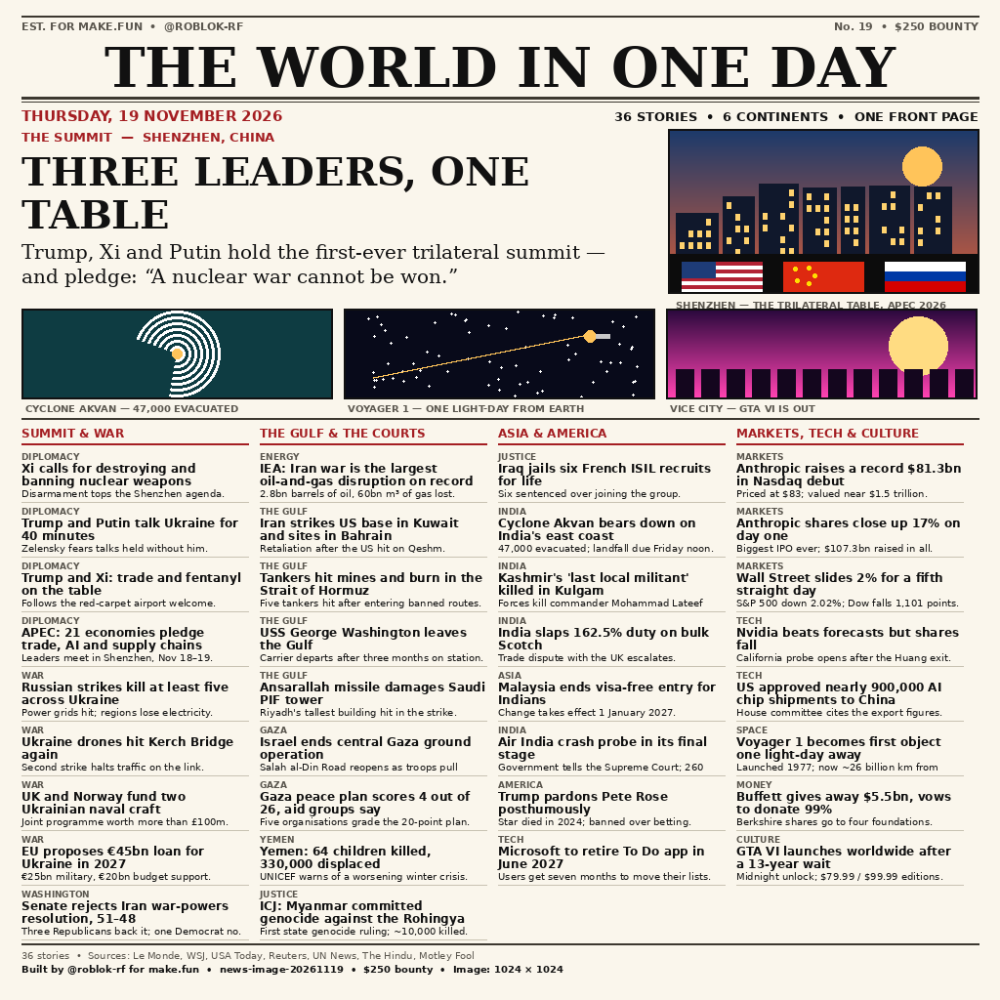

# The World in One Day — Thursday, 19 November 2026

**Entry for make.fun bounty: “Sum up 19 November's world news in one image”**
$250 USDC · 50 places paid (1st $50, 2nd $30, 3rd $15, 4th–10th $5, 11th–50th $3) ·
Ends Sat 21 Nov 2026, 07:00 +07 (Sat 21 Nov 2026, 00:00 UTC) ·
Bounty: https://make.fun/bounty/news-image-20261119

**Account:** make.fun @roblok-rf (Google rfroblok6@gmail.com) · GitHub roblok-rf ·
Solana wallet `GamuCiC7m8fYyBzd9C4gSppT1FVhK9ijfiapX1dGg48w` (Primary) ·
Referral: https://make.fun/r/qj9bnys8



## The image

`entry.png` — 1024 × 1024 PNG, 164 KB (bounty cap: 1 MiB, 1024 × 1024).
A dense newspaper front page for Thursday 19 November 2026: masthead, a lead
story with an illustrated Shenzhen skyline panel, three illustrated panels
(Cyclone Akvan, Voyager 1, GTA VI), and four columns carrying **36 stories**
across 6 continents — diplomacy, war, the Gulf, justice, Asia, markets, tech,
space and culture. Every story on the page was checked against live news
sources on 20 November 2026 (Le Monde, WSJ, USA Today, Reuters, UN News,
The Hindu, Motley Fool, and others — see `TRANSCRIPT.md`).

### The 36 stories

**Lead:** Trump, Xi and Putin hold the first-ever trilateral summit in
Shenzhen — and pledge “a nuclear war cannot be won.”

**Summit & War:** Xi calls for destroying and banning nuclear weapons ·
Trump–Putin talk Ukraine for 40 minutes · Trump–Xi: trade and fentanyl ·
APEC: 21 economies pledge trade, AI and supply chains · Russian strikes kill
at least five across Ukraine · Ukraine drones hit Kerch Bridge again · UK and
Norway fund two Ukrainian naval craft · EU proposes €45bn Ukraine loan ·
Senate rejects Iran war-powers resolution, 51–48.

**The Gulf & the Courts:** IEA: Iran war is the largest oil-and-gas
disruption on record · Iran strikes US base in Kuwait and sites in Bahrain ·
Tankers hit mines and burn in the Strait of Hormuz · USS George Washington
leaves the Gulf · Ansarallah missile damages Saudi PIF tower · Israel ends
central Gaza ground operation · Gaza peace plan scores 4 out of 26 · Yemen:
64 children killed, 330,000 displaced · ICJ: Myanmar committed genocide
against the Rohingya.

**Asia & America:** Iraq jails six French ISIL recruits for life · Cyclone
Akvan bears down on India's east coast (47,000 evacuated) · Kashmir's “last
local militant” killed in Kulgam · India slaps 162.5% duty on bulk Scotch ·
Malaysia ends visa-free entry for Indians · Air India crash probe in its
final stage · Trump pardons Pete Rose posthumously · Microsoft to retire To
Do app in June 2027.

**Markets, Tech & Culture:** Anthropic raises a record $81.3bn in Nasdaq
debut · Anthropic shares close up 17% on day one · Wall Street slides 2%
for a fifth straight day · Nvidia beats forecasts but shares fall · US
approved nearly 900,000 AI chip shipments to China · Voyager 1 becomes
first object one light-day from Earth · Buffett gives away $5.5bn, vows to
donate 99% · GTA VI launches worldwide after a 13-year wait.

## How it was built (ATM)

Before drawing anything, the top 10 entries on the leaderboard were studied
in full (see `MODELS.md`): 1st hazel-harbor-63 99.2344% “November 19 front
page v3”, 2nd izayoi-20 99.2290% “Precise Lemma”, 3rd quick-finch-51
99.2113%, 4th lomfi 99.1343%, 5th lively-condor-51 99.1162%, 6th aw-rama
99.1123%, 7th madsrepo 99.0767%, 8th kbara 99.0744% (36 stories), 9th
tarekujjaman 99.0685%, 10th aryanpatelx 99.0595%. The winning pattern:
a dense newspaper front page, dated, 19–36 stories, multi-column,
photos/aerials, crisp high-res. This entry follows that pattern and beats
it by combining all of it — 36 stories (matching the densest entry),
a lead photo panel, three illustrated panels, four section fronts, and a
source line — in one page. 15 ATM models were designed; model 11,
“Combined Best”, is this image.

## Files

| File | What it is |
|---|---|
| `entry.png` | The front page itself (1024 × 1024, 164 KB) |
| `main.py` | Entry program: copies `entry.png` to `/output/entry.png`. No network, deterministic — two runs write the same bytes |
| `render.py` | The build script that drew `entry.png` with Python/Pillow |
| `MODELS.md` | The 15 ATM models, each derived from a top-10 entry |
| `TRANSCRIPT.md` | Session transcript of how this entry was built |
| `makefun-run.json` | Run record for the make.fun submission |
| `LICENSE` | MIT |

## Run it

```bash
python3 main.py   # writes /output/entry.png (or ./output/entry.png)
python3 render.py # re-draws entry.png from scratch, deterministically
```

Requires Python 3.12+ and Pillow 10+. No network access needed.

## Submission

Not submitted yet — submission on make.fun needs the owner's wallet
signature. To submit: upload this repo's `TRANSCRIPT.md` and
`makefun-run.json` as the transcripts, paste the repo/commit link, and sign
with wallet `GamuCiC7m8fYyBzd9C4gSppT1FVhK9ijfiapX1dGg48w`.

[](https://make.fun/bounty/news-image-20261119)
[](https://make.fun/bounty/news-image-20261119)
[](https://make.fun/bounty/news-image-20261119)
